# DragonStone

DragonStone is a full-stack e-commerce web application focused on sustainable and eco-friendly products.

The platform was developed as a university software engineering project using PHP, MySQL, HTML, CSS and JavaScript. It combines traditional e-commerce functionality with sustainability-focused features such as EcoPoints, rewards, community participation and product carbon-footprint estimates.

## Features

### E-Commerce

- Product browsing by category
- Product detail pages
- Shopping cart functionality
- Checkout process
- Order creation and tracking
- Product inventory management
- User registration and authentication

### User Accounts

- Customer registration and login
- Personal account dashboard
- EcoPoints balance
- Order history and tracking
- Reward redemption

### EcoPoints & Rewards

DragonStone includes a sustainability-focused rewards system that allows users to earn EcoPoints through platform activity.

Users can:

- Earn EcoPoints from purchases and selected activities
- View their current EcoPoints balance
- Browse available rewards
- Redeem rewards when they have enough points

### Carbon Footprint

Products can include estimated carbon-impact information.

The application can calculate an estimated CO₂ saving based on the selected product and quantity and return this information through the footprint API.

### Community Hub

Registered users can participate in the DragonStone community by:

- Creating sustainability-related posts
- Viewing community discussions
- Commenting on posts
- Sharing eco-friendly ideas and tips

### Administration

The admin area provides tools for managing the application, including:

- Products
- Users
- Orders
- Rewards
- Community content
- Comments and moderation

The admin dashboard also includes summary information such as:

- Total sales
- Total users
- Total products
- EcoPoints activity
- Product carbon-footprint estimates
- Monthly revenue
- Product category statistics

## Tech Stack

**Backend**
- PHP
- PDO
- MySQL

**Frontend**
- HTML5
- CSS3
- JavaScript
- Bootstrap

**Database**
- MySQL
- Relational database design
- Foreign-key relationships

**Additional Technologies**
- Chart.js
- PayPal Sandbox integration
- XAMPP
- phpMyAdmin

## Database Design

DragonStone uses a relational MySQL database containing structures for:

- Roles
- Users
- Categories
- Products
- Product footprint data
- Shopping carts
- Cart items
- Rewards
- Reward redemptions
- Orders
- EcoPoints
- Community posts
- Community comments
- Community likes
- Content moderation

The database schema and sample seed data are available in:

```text
sql/dragonstone_schema_and_seed.sql
```

## Project Structure

```text
DragonStone/
│
├── admin/                  # Administrative dashboard and management pages
├── public/                 # Customer-facing application
│   ├── assets/             # CSS, JavaScript and images
│   ├── partials/           # Shared page components
│   └── uploads/            # Product images
│
├── sql/
│   └── dragonstone_schema_and_seed.sql
│
├── src/
│   ├── actions/            # Application actions
│   ├── api/                # Application API endpoints
│   ├── config.php          # Global application configuration
│   ├── db.php              # Database connection
│   ├── csrf.php            # CSRF functionality
│   └── helpers.php         # Shared helper functions
│
├── login.php
├── logout.php
├── register.php
└── README.md
```

## Local Setup

### Requirements

- XAMPP or equivalent Apache/PHP/MySQL environment
- PHP
- MySQL
- phpMyAdmin

### Installation

1. Clone the repository:

```bash
git clone https://github.com/SiveCosa/Dragonstone.git
```

2. Move the project into your XAMPP `htdocs` directory if required.

Example:

```text
C:\xampp\htdocs\DragonStone
```

3. Start **Apache** and **MySQL** from XAMPP.

4. Open phpMyAdmin and import:

```text
sql/dragonstone_schema_and_seed.sql
```

5. Review the database configuration in:

```text
src/db.php
```

6. Review the application configuration in:

```text
src/config.php
```

7. Open the application:

```text
http://localhost/DragonStone/public/
```

### Admin Area

The admin interface is available at:

```text
http://localhost/DragonStone/admin/
```

The included database seed contains a placeholder administrator account. A valid password hash should be generated using the included admin creation script before using the account.

## Payment Integration

The project includes PayPal integration support.

The repository contains placeholder PayPal credentials only:

```text
PAYPAL_CLIENT_ID
PAYPAL_SECRET
```

To test payments, your own PayPal Sandbox credentials must be configured locally.

No production payment credentials are included in this repository.

## Screenshots

### Customer Website — Desktop

#### Home
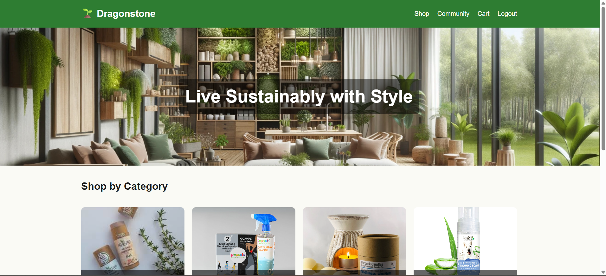

#### Categories
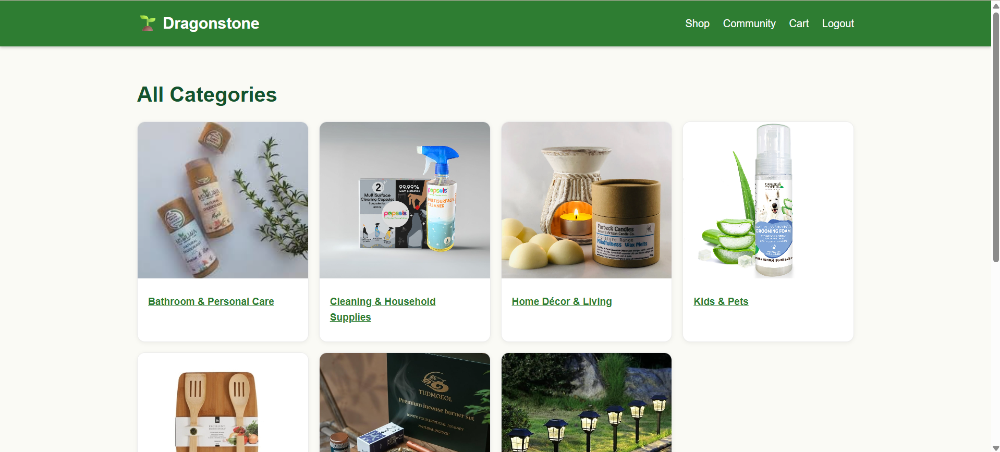

#### Product & Cart Flow
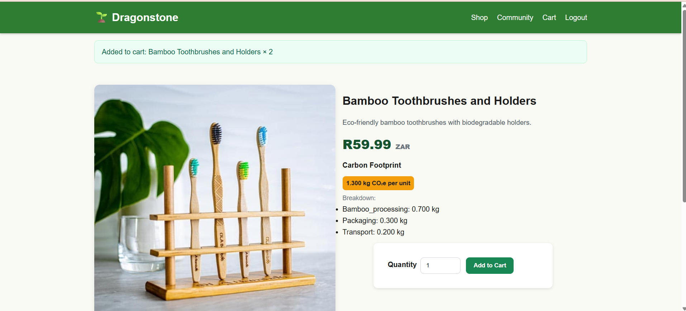

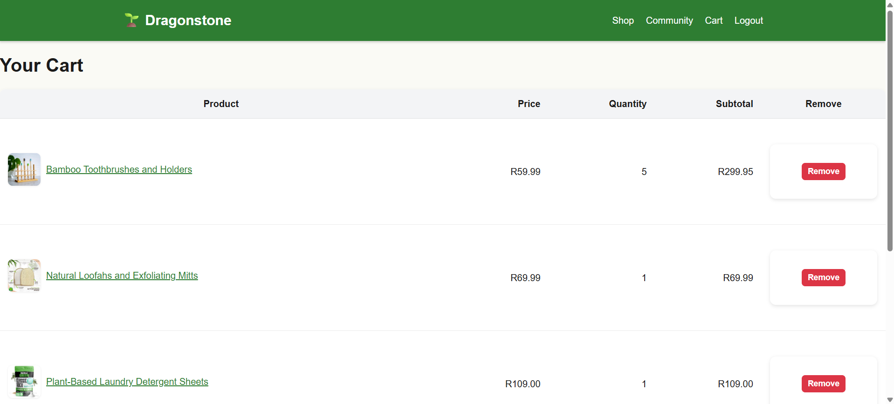

#### Checkout
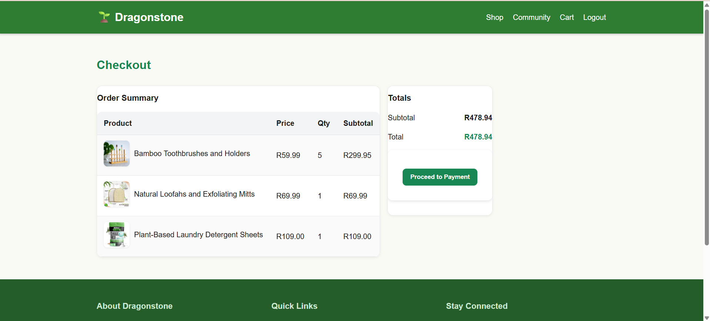

### Customer Website — Mobile

#### Home
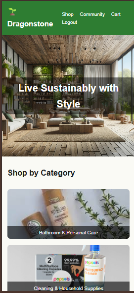

#### Categories
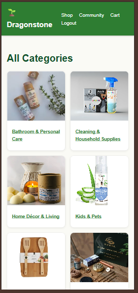

#### Product & Cart Flow
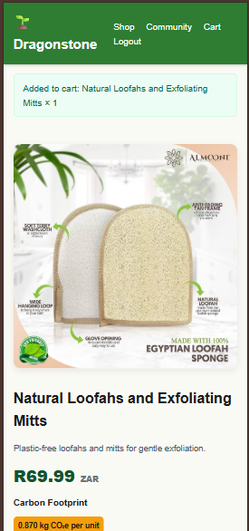

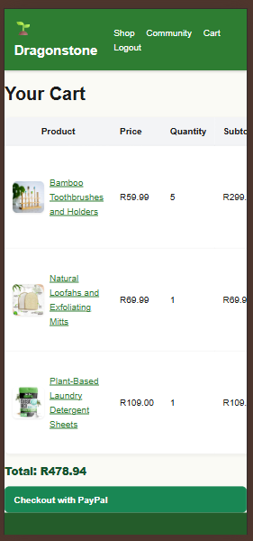

#### Checkout
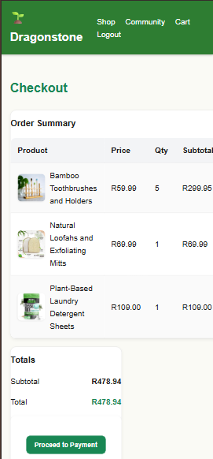

### Admin Portal — Desktop

#### Dashboard
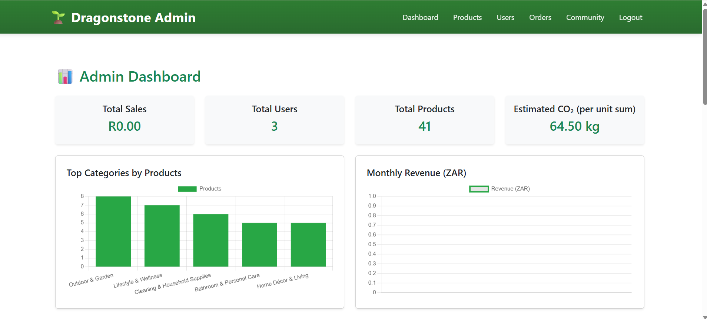

#### Product Management
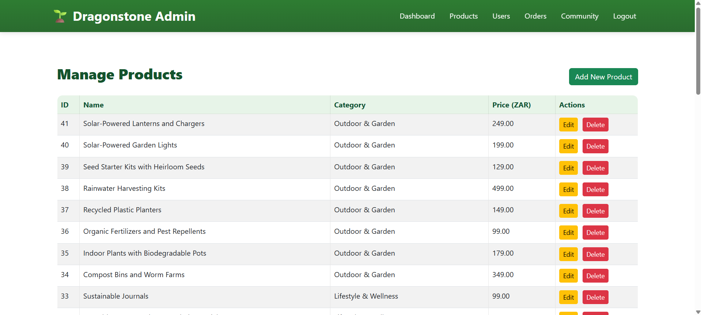

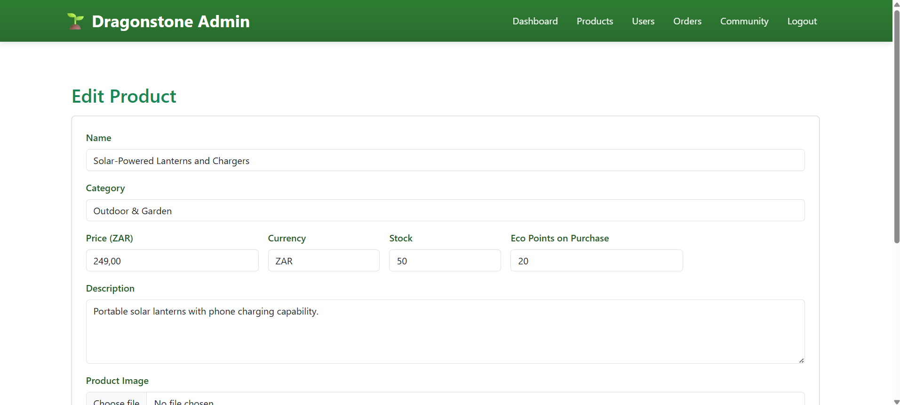

#### User Management
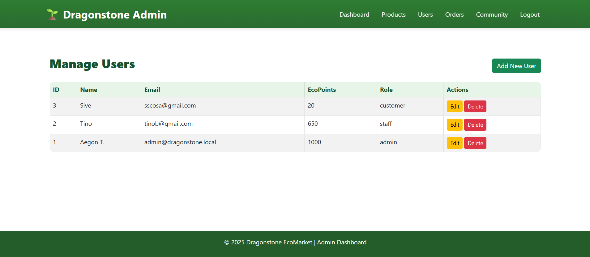

### Admin Portal — Mobile

#### Dashboard


#### Product Management


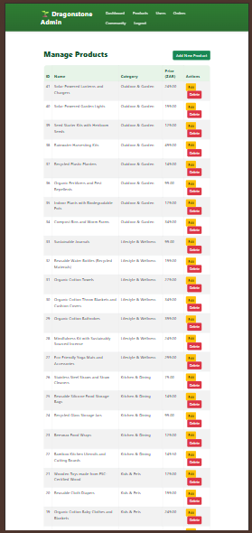

#### Community Management
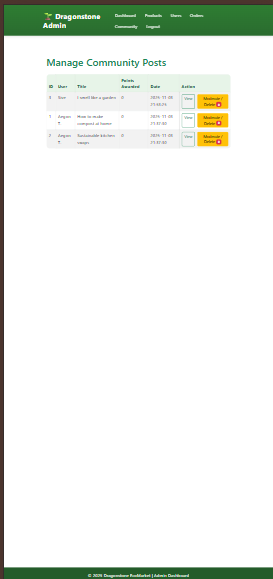


## What I Learned

This project provided practical experience with:

- Full-stack PHP development
- Relational database design
- MySQL integration using PDO
- User authentication and role-based access
- CRUD operations
- Shopping-cart and checkout workflows
- Session management
- Form handling and validation
- Administrative dashboards
- API-style PHP endpoints
- Sustainability-focused application features
- Git and GitHub version control

## Project Context

DragonStone was developed as a university project to demonstrate full-stack web development, relational database integration and e-commerce application design.

The project is intended as a portfolio demonstration of my software-development skills rather than a production e-commerce service.

## Author

**Sive Cosa**

BSc Information Technology graduate specialising in Software Engineering.

- GitHub: [SiveCosa](https://github.com/SiveCosa)
- LinkedIn: To be added after profile update
